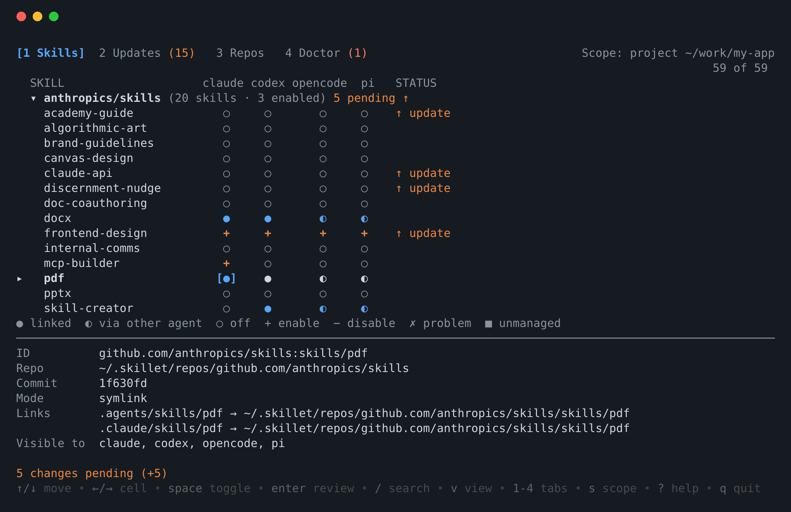
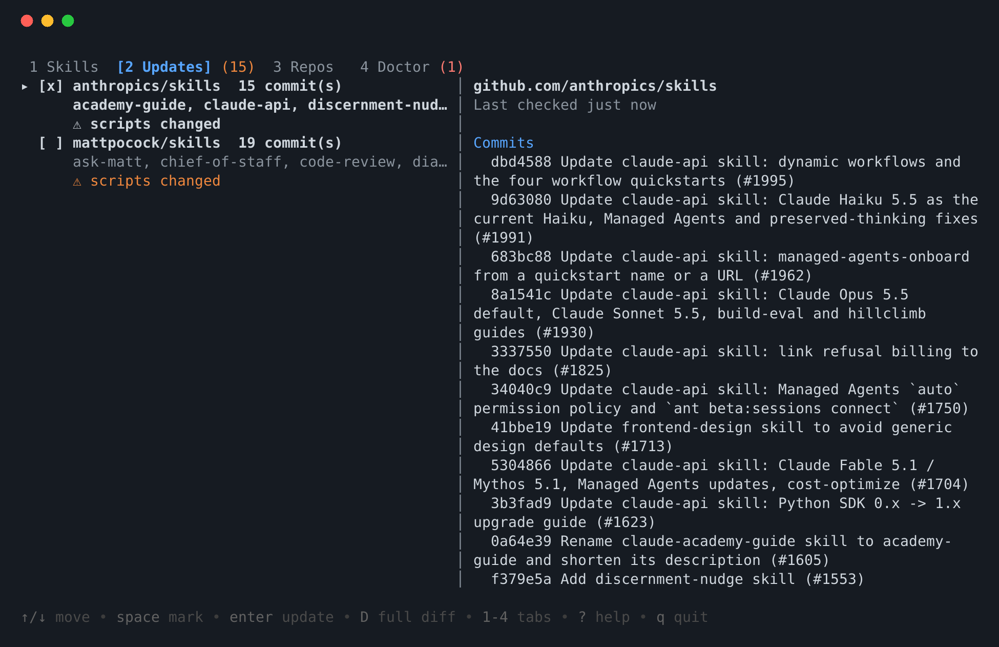

# skillet

English | [简体中文](README.zh-CN.md)

Clone the git repositories that hold your skills into one directory, then enable them per "project directory × agent" with symlinks. Supports Claude Code, Codex, OpenCode and pi, and runs on Linux, macOS and Windows.

See [docs/design.md](docs/design.md) for the design and [docs/research.md](docs/research.md) for the background research.

## Build

```bash
go build -o bin/skillet ./cmd/skillet
```

Requires `git` to be installed.

## Usage

### Terminal UI (TUI)

```bash
skillet            # run without a subcommand in a terminal to open the UI
skillet tui        # same; with no terminal, --no-input, SKILLET_NO_INPUT or CI, `skillet` just prints help
```





Four tabs, switched with `1`–`4` (or `tab`):

- **Skills**: a skill × agent matrix. `↑/↓` move, `←/→` pick the agent column, `space` toggles the current cell (`+` pending enable, `−` pending disable), `a` toggles the whole row, `enter` previews and applies, `esc` clears pending changes; `f` shows only enabled skills, `/` searches, `p` pins a version, `R` renames the link. Skills are grouped by repository and all groups start collapsed: `space`/`enter` collapses or expands a repository, `z` collapses/expands all, `v` switches to a flat view; `s` cycles the scope through project → global → all ("all" is read-only).
- **Updates**: repositories with upstream changes. `space` selects, `r` checks online, `D` shows the full diff, `enter` updates.
- **Repos**: `n` adds, `x` removes (with a preview first), `enter` shows that repository's skills, `u` jumps to updates.
- **Doctor**: problems grouped by severity. `F` fixes everything fixable, `enter` jumps to the related skill.

`?` shows all keys, `q` quits. Every change is previewed as a dry run and only executed after you confirm; the TUI does not hold the state lock while you are thinking.

UI language: the `SKILLET_LANG` environment variable (`zh` / `en`) wins, then `lang = "zh"` in `config.toml`, then `LC_ALL` / `LC_MESSAGES` / `LANG` (Chinese if it starts with `zh`); the default is English. Command-line output is always English.

### Command line

```bash
skillet init --store ~/skills-store          # choose where repositories are stored
skillet repo add anthropics/skills            # also accepts an https/ssh URL or a local path (--dry-run shows where it would be cloned)
skillet list                                  # list available skills

cd ~/work/projA
skillet enable pdf -a claude,codex            # enable in the current project (git root)
skillet enable pdf -a all --dry-run           # see which links would be created
skillet enable pdf -a claude -g               # enable at user (global) level
skillet status                                # skill × agent matrix; -l shows each link path
skillet enable weird_name -a claude --as weird-name   # use a different link name for invalid or clashing names
skillet status --all                          # every scope with deployments (global + each project)
skillet disable pdf -a claude                 # disable for claude only
skillet disable pdf                           # disable everywhere
skillet enable                                # in a terminal: pick skills and agents interactively, preview, confirm (--yes skips confirmation)
skillet disable                               # in a terminal: pick from skills deployed in this directory
# --no-input or SKILLET_NO_INPUT=1 / CI disables all prompts

skillet check                                 # fetch all repositories and list skills that changed upstream
skillet update                                # review commit log and diffstat, then fast-forward after confirming
skillet update --diff                         # show the full diff (recommended when scripts changed)
skillet update -y                             # update without asking
skillet update --dry-run                      # fetch and only show what would be applied, no prompt, no merge
skillet pending [--json]                      # results of the last check (offline)
skillet doctor [--fix] [--json]               # broken links, deleted projects, name clashes

skillet save [--dry-run]                      # write the current project's skills to skillet.toml (commit it to git)
skillet restore [--dry-run] [--prune]         # teammates restore the same skills with one command after cloning

skillet repo remove anthropics/skills --force # (preview with --dry-run) delete a repository and all its links
skillet repo show anthropics/skills           # repository details: commits behind, pinned checkouts, skills and where they're deployed (--json)
skillet agents                                # directories each agent reads and whether it is installed (--json)
```

When skill names clash, use `owner/repo/name` or the full id (the `id` field in `skillet list --json`).

## Behavior

- **Minimal links**: OpenCode also reads `.claude/skills` and `.agents/skills`, and pi also reads `.agents/skills`. So `-a all` creates only two links: `.claude/skills/<name>` and `.agents/skills/<name>`. After every operation skillet prints which agents can actually see the skill.
- **Never touches what isn't its own**: if the target already holds a directory or link that skillet did not create, the whole operation is refused and nothing is changed.
- **Windows**: tries symlink, then junction (no admin rights needed), then copy. Copied directories contain a `.skillet-source.json` used to identify them and detect manual edits. Force a mode with `--mode` or `link_mode` in the config.
- **Updates**: `check` only counts commits that actually touch a skill's directory as updates, and flags skills whose scripts or other non-Markdown files changed. After `update`: symlinks take effect automatically; copies are re-copied, skipping manually edited ones; renamed or moved skills are relinked; skills deleted upstream have their links removed. Updates are refused when a repository in the store has local changes or has diverged.
- **Config**: `~/.config/skillet/config.toml` (`%AppData%\skillet` on Windows), overridable with the `SKILLET_CONFIG_DIR` environment variable. Use `[[agents]]` there to override or add agents:

  ```toml
  [[agents]]
  id = "hermes"
  project_dir = ".hermes/skills"
  global_dir = "~/.hermes/skills"
  ```

## Progress

- [x] M1: init, repo add/list/remove, list, enable/disable, status, agents, links on all three platforms
- [x] M2: check / update (per-skill subdirectory change detection, diff review, copy resync), doctor
- [x] M3: passive reminders + background checks, `schedule install/remove`, `check --notify/--quiet`, `pending`, `hook claude`
- [x] M4: version pinning (`enable --pin`, git worktree); team manifest `skillet.toml` (`save` / `restore`, kept in sync by later `enable`/`disable`); interactive selection (huh multi-select when `enable`/`disable` lack arguments, disabled by `--no-input`); `repo show`, `status --all`, `enable --as`, agent detection, `doctor --json`
- [x] TUI (`skillet` / `skillet tui`, bubbletea v2): Skills matrix (toggle, preview, apply, pin, alias), Updates, Repos and Doctor tabs, Chinese and English UI. Not yet verified in a real terminal, on light backgrounds, or on Windows / macOS.
