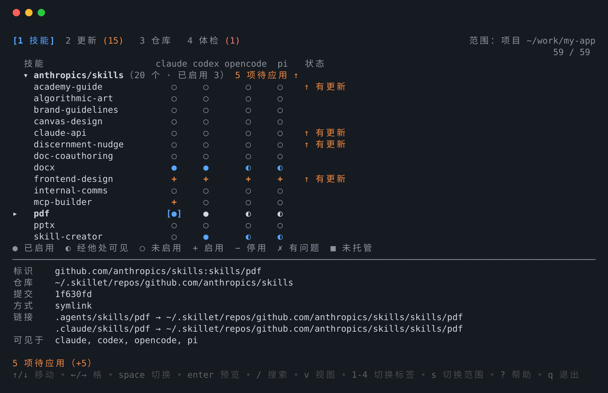
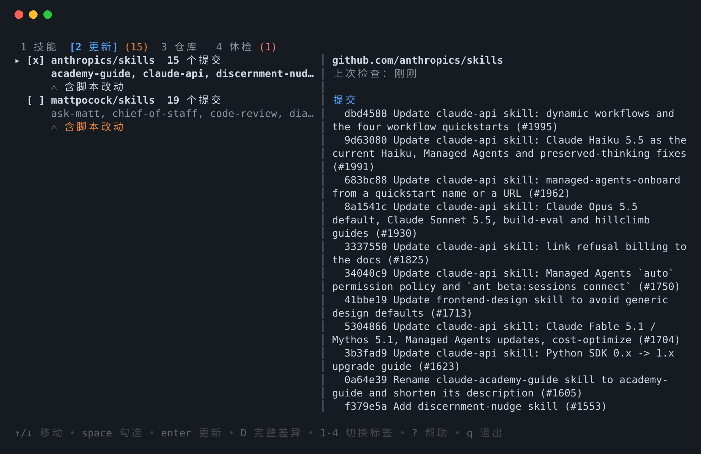

<div align="center">

# skillet

**用 git 仓库统一管理 Claude Code、Codex、OpenCode、pi 的 agent skill。**

[](https://github.com/finalsatan/skill-manager/actions/workflows/ci.yml)
[](go.mod)
[](LICENSE)

[English](README.md) | 简体中文



</div>

## 为什么用 skillet？

skill 都放在 git 仓库里，但每个 coding agent 读取的目录各不相同，手动复制过去之后就再也不会更新。skillet 把每个 skill 仓库作为完整的 git clone 集中放在一个目录，按项目、按 agent 把需要的 skill 链接过去，并在上游有变化时提醒你——更新前可以先看提交记录和 diff。

## 特性

- **git 仓库就是来源**：`skillet repo add owner/repo` 直接 clone，链接指向 clone 里的目录，不需要同步。
- **按「项目 × agent」启用**：可以只在某个项目里给 Claude Code 开，也可以全局给所有 agent 开；命令行和 TUI 矩阵都能操作。
- **最少链接，如实告知可见性**：skillet 知道每个 agent 读哪些目录，尽量少建链接，并打印每个 skill 实际对哪些 agent 可见。
- **更新先审阅**：`check` 只报告自身目录在上游有变化的 skill，并标出改了脚本的；`update` 先展示提交记录和 diff，再 fast-forward。
- **团队清单**：`skillet save` 生成 `skillet.toml`，队友 clone 项目后 `skillet restore` 一条命令还原。
- **安全、跨平台**：从不覆盖不是自己创建的文件；支持 Linux、macOS、Windows（symlink → junction → 复制）。

## 支持的 agent

| Agent | 项目级目录 | 全局目录 |
|---|---|---|
| Claude Code | `.claude/skills` | `~/.claude/skills` |
| Codex | `.agents/skills` | `~/.agents/skills` |
| OpenCode | `.opencode/skills`（也读 `.claude/skills`、`.agents/skills`） | `~/.config/opencode/skills` |
| pi | `.pi/skills`（也读 `.agents/skills`） | `~/.pi/agent/skills` |

其他 agent 可以在配置文件里添加，见[配置](#配置)。

## 安装

需要系统里装有 `git`。

**预编译二进制**：[Releases](https://github.com/finalsatan/skill-manager/releases) 页面提供 Linux、macOS、Windows（amd64 / arm64）版本，下载对应平台的压缩包，解压后把 `skillet` 放进 `PATH` 即可。

**用 Go 安装**：

```bash
go install github.com/finalsatan/skill-manager/cmd/skillet@latest
```

或从源码构建：

```bash
git clone https://github.com/finalsatan/skill-manager.git
cd skill-manager
go build -o bin/skillet ./cmd/skillet
```

## 快速上手

```bash
skillet init                          # 创建配置和存放仓库的目录（默认 ~/.skillet）
skillet repo add anthropics/skills    # clone 一个 skill 仓库（owner/repo、URL 或本地路径）
skillet list                          # 查看它提供的 skill

cd ~/work/my-project
skillet enable pdf -a claude,codex    # 在当前项目里为 Claude Code 和 Codex 启用
skillet status                        # 当前项目的 skill × agent 矩阵
```

也可以直接运行不带参数的 `skillet`，在终端界面里完成以上操作。

## 常用命令

| 命令 | 作用 |
|---|---|
| `skillet enable <skill> -a <agents>` | 把 skill 链接到项目（`-g` 全局，`--dry-run` 预览） |
| `skillet disable <skill> [-a <agents>]` | 删除链接 |
| `skillet status [--all]` | 查看每个 agent 能看到哪些 skill |
| `skillet check` | fetch 所有仓库，列出上游有变化的 skill |
| `skillet update [--diff]` | 审阅上游提交后 fast-forward |
| `skillet doctor [--fix]` | 查找并修复失效链接、同名冲突 |
| `skillet save` / `skillet restore` | 写入 / 应用项目的 `skillet.toml` |
| `skillet schedule install` | 在后台定期检查更新 |
| `skillet hook claude` | 输出一个提示待更新 skill 的 Claude Code hook |

每个命令的全部参数见 `skillet <command> --help`，或查看完整的[使用指南](docs/usage.zh-CN.md)。

## 终端界面

在终端里运行 `skillet`（或 `skillet tui`）。四个标签，按 `1`–`4` 切换：

- **技能**：skill × agent 矩阵，`space` 切换格子，`enter` 预览并应用。
- **更新**：各仓库的上游变更，一键查看完整 diff。
- **仓库**：添加、移除 skill 仓库。
- **体检**：按严重程度分组的问题，一键修复。



所有改动都先 dry-run 预览再执行。按 `?` 查看全部按键，[使用指南](docs/usage.zh-CN.md#终端界面)里也有完整列表。界面支持中英文（`SKILLET_LANG=zh`）。

## 配置

配置文件是 `~/.config/skillet/config.toml`（Windows 为 `%AppData%\skillet`），可用环境变量 `SKILLET_CONFIG_DIR` 指定其他位置。用 `[[agents]]` 新增或覆盖 agent：

```toml
[[agents]]
id = "hermes"
project_dir = ".hermes/skills"
global_dir = "~/.hermes/skills"
```

## 工作原理

- **最少链接**：OpenCode 也读 `.claude/skills` 和 `.agents/skills`，pi 也读 `.agents/skills`，所以 `-a all` 只建两条链接：`.claude/skills/<name>` 和 `.agents/skills/<name>`。
- **不碰别人的东西**：目标位置已有不是 skillet 创建的目录或链接时，整个操作都会被拒绝，不做任何改动。
- **Windows**：依次尝试 symlink、junction（不需要管理员权限）、复制。复制出来的目录里有 `.skillet-source.json`，用来识别和检测手动修改。可用 `--mode` 或配置里的 `link_mode` 强制指定。
- **更新**：软链接自动生效；复制的副本会重新复制，手动改过的跳过；改名或换目录的 skill 会重新链接；上游删除的 skill 会删掉链接。有本地修改或已分叉的仓库不会被更新。

完整设计见 [docs/design.md](docs/design.md)，各 agent 如何发现 skill 的调研见 [docs/research.md](docs/research.md)。

## 状态

规划的功能都已实现，CI 在 Linux、macOS、Windows 上运行。TUI 还没在浅色终端背景、真实的 Windows / macOS 终端里试过，欢迎反馈问题。

## 参与贡献

欢迎提 issue 和 pull request。提交改动前请运行：

```bash
go vet ./...
go test ./...
```

## 许可证

[MIT](LICENSE)
